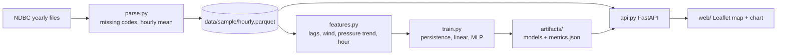

# buoycast

I built a small wave-height forecaster from real ocean buoy measurements because, after working with ocean simulation data during my summer 2026 co-op at Fisheries and Oceans Canada, I wanted to try the other side: real measurements from the water, and whether a small neural network can forecast waves better than simple guesses.

[](https://github.com/andyhetianjun/buoycast/actions/workflows/ci.yml)

## What it does

Buoys float at sea and record wave height, wind and air pressure every hour or so. This project takes three years of public records from six buoys (NOAA's National Data Buoy Center), cleans them, and predicts the wave height 3 and 6 hours ahead. It then checks those predictions against two simple guesses:

- **Persistence:** "the waves will stay the same as right now."
- **Linear regression:** a straight-line formula fitted to recent readings.

A small neural network (an MLP, which is a few layers of simple number-crunching units that learn from examples) is compared against both. A web page shows the buoys on a map, and clicking one shows its forecast and a 72-hour chart of what was observed against what was predicted.

Short version of the result: the neural network beat both guesses on months it never saw, by a modest margin (about 18% lower error than persistence at 3 hours). Caveats are below.

## Try it

You need [uv](https://docs.astral.sh/uv/). The data sample is committed, so nothing is downloaded.

```
uv sync
uv run buoycast-serve           # then open http://127.0.0.1:8000
```

The map page loads map tiles from the internet; the forecasting itself works offline. Because the data is a fixed historical sample, "now" is the last hour in it. The "Window ends" box lets you move back in time (the test period starts on 2024-07-01).

API endpoints the page uses:

- `GET /stations`: stations with position and first/last observation time.
- `GET /observations?station=46041&hours=48&end=...`: hourly wave height, wind speed and pressure.
- `GET /forecast/{station}?as_of=...`: 3 h and 6 h forecasts from the three methods, using only data up to `as_of`.
- `GET /backtest/{station}?horizon=3&hours=72&end=...`: forecasts made earlier next to what was observed.

## Results

Test period 2024-07 to 2024-12, stations 44027, 45005, 45012, 46005 and 46041 (17,548 rows at 3 h, 17,536 at 6 h). MAE is the average miss in metres; RMSE is similar but punishes big misses more. MLP rows are the mean and standard deviation over 5 random seeds (0 to 4).

| Horizon | Model | MAE (m) | RMSE (m) |
|---|---|---|---|
| 3 h | Persistence | 0.163 | 0.256 |
| 3 h | Linear regression | 0.147 | 0.228 |
| 3 h | MLP | 0.133 +/- 0.000 | 0.212 +/- 0.001 |
| 6 h | Persistence | 0.258 | 0.407 |
| 6 h | Linear regression | 0.236 | 0.365 |
| 6 h | MLP | 0.211 +/- 0.001 | 0.339 +/- 0.002 |

MAE by the observed wave height at the forecast time (MLP here is the average of the 5 seeds' predictions):

| Observed height | 3 h persistence | 3 h linear | 3 h MLP | 6 h persistence | 6 h linear | 6 h MLP |
|---|---|---|---|---|---|---|
| under 1 m | 0.103 | 0.094 | 0.077 | 0.159 | 0.155 | 0.121 |
| 1 to 2 m | 0.137 | 0.130 | 0.117 | 0.210 | 0.203 | 0.181 |
| 2 to 3 m | 0.228 | 0.197 | 0.185 | 0.380 | 0.312 | 0.302 |
| over 3 m | 0.431 | 0.375 | 0.349 | 0.704 | 0.607 | 0.554 |

To reproduce (fixed seeds, CPU only, about 5 seconds on my laptop):

```
uv sync
uv run buoycast-train
```

This rewrites `artifacts/metrics.json` and the two model files, and prints the first table. I get the same numbers on repeated runs on my machine; I have not checked other machines or PyTorch versions.

## Limitations

- Persistence is hard to beat by much. At 3 hours waves mostly do not change, so the best model only cuts the average miss from 0.163 m to 0.133 m. That 3 cm is small in practice at calm stations.
- The MLP beat linear regression in every row (by about 0.014 m at 3 h and 0.025 m at 6 h), but I did not try other model types (such as a GRU or 1D-CNN) or tune settings, so I can only say it beat what I compared against.
- There is one test period and one split: six months of data from five stations. That is not enough to claim this holds in other seasons.
- The test months are July to December. There is no winter, and the Great Lakes buoys have no winter data, so the hardest conditions are underrepresented. Errors grow quickly with wave height (over 3 m the 6 h MAE is 0.55 m). Grouping by the observed height conditions on the outcome, so that table is a way to look at errors, not a fair measure of skill.
- The model only sees past buoy readings, not a weather forecast, which limits how good it can get, especially at 6 hours.
- Station differences are handled only by a one-hot station id (a column of 0s and 1s saying which buoy a row is from). I did not test a station the model never saw in training.
- The validation months were used only to decide when to stop training, but I looked at the test period once per code change while building, so the test numbers are not fully untouched.

## How it works



The raw files mark missing readings with codes like 99 or 999, which the parser turns into blanks so a missing reading never becomes a 99 m wave. Everything is averaged to hourly. For each hour the model sees the recent past (wave height over the last 24 hours, wind, pressure and its trend, time of day, which buoy) and predicts the wave height 3 or 6 hours later. The data is split by time (train on 2022 to 2023, stop-early check on 2024 H1, test on 2024 H2), and a test checks that no future reading leaks into earlier features. The data caveats, feature list and model settings are in [docs/design.md](docs/design.md).

## Tests and CI

```
uv run pytest -q
uv run ruff check . && uv run ruff format --check .
uv run buoycast-train --quick   # tiny run used in CI (1 seed, 2 epochs, temp output)
```

GitHub Actions runs the tests, lint, the quick training run and a Docker image build on every push. I wrote the Dockerfile (`docker build -t buoycast . && docker run -p 8000:8000 buoycast`) but have not built it on my own machine, so it is only checked by CI.

To refresh the sample from NOAA: `uv run buoycast-download`. Re-downloading may change the numbers, since NOAA can revise files.

## What I'd try next

- Hold out a whole station and see how the model does on it.
- Try a GRU or 1D-CNN, and gradient boosted trees.
- Add weather forecast winds as inputs.
- Evaluate across several seasons instead of one split.
- Use NDBC's live files so the map shows the current ocean.

## License

MIT
