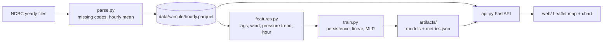

# buoycast

[](https://github.com/andyhetianjun/buoycast/actions/workflows/ci.yml)

I wanted to see how much a small neural network can improve on "the waves will stay the same" when forecasting wave height a few hours ahead from buoy data. This project downloads real NOAA buoy records, cleans them, trains a small PyTorch model for 3 and 6 hours ahead, compares it with two simple baselines, and serves the forecasts through a FastAPI app with a map page.

Short version of the result: the MLP is better than both baselines on the held-out test months, by a modest margin (about 18% lower error than persistence at 3 hours). Details and caveats are below.

## Data

NOAA National Data Buoy Center (NDBC), historical standard meteorological data, <https://www.ndbc.noaa.gov/data/historical/stdmet/>. This is public data. Station names and positions come from NDBC's active stations list.

| Station | Where | Region |
|---|---|---|
| 44005 | Gulf of Maine | Atlantic, near Canadian waters |
| 44027 | Jonesport, Maine | Atlantic, Bay of Fundy side |
| 45005 | West Erie | Great Lakes |
| 45012 | East Lake Ontario | Great Lakes |
| 46041 | Cape Elizabeth, Washington | Pacific Northwest |
| 46005 | West Washington (offshore) | Pacific Northwest |

Years 2022 to 2024. I looked for a working public DFO/MEDS endpoint but went with NDBC because the files are simple and stable. The processed hourly table (117,495 rows, 1.8 MB) is committed in `data/sample/hourly.parquet`, so everything runs offline.

Things in the data worth knowing:

- Missing values are written as 99, 999 or 9999 depending on the column. The parser turns these into NaN, so a missing wave reading never becomes a 99 m wave.
- Lake buoys report every 10 minutes and ocean buoys every 30 or 60 minutes, so everything is averaged to hourly. Wind direction is averaged as a vector.
- Some sensors have long gaps. The air temperature at 44027 and 46041 is missing for most of 2024, so I left air and water temperature out of the features instead of throwing away those stations.
- 44005 has data only until 2024-03-25 in the NDBC historical folder, so it has no test rows.
- The Great Lakes buoys are taken in over winter, so they have no winter data.

## How it works



Features at time t (all use only data from t or earlier): wave height at lags 0, 1, 2, 3, 6, 12, 24 hours, wind speed at several lags, gust, wind as east/north components (now and 3 hours ago), dominant wave period, pressure and its change over 3 and 12 hours, time of day as sin/cos, and a one-hot station id. Gaps of up to 2 hours are filled forward from the last past value; any row with a missing feature is dropped.

The target is the wave height at t+3 h or t+6 h. The linear model and the MLP both predict the change from the current wave height, so "no change" is where they start.

Split by time, so no future data leaks into training:

| Split | Period | Used for |
|---|---|---|
| Train | 2022-01-01 to 2023-12-31 | fitting, and the scaler |
| Validation | 2024-01-01 to 2024-06-30 | early stopping only |
| Test | 2024-07-01 to 2024-12-31 | the numbers below |

A row only goes into a split if its label time is inside that split as well, so rows near a boundary are dropped. `tests/test_features.py` checks the no-leakage rule by scrambling everything after a cutoff and confirming earlier features do not change.

The MLP is two hidden layers of 64 units, Huber loss, AdamW, up to 40 epochs with early stopping on validation MAE. One model is trained for each horizon, pooled over all stations.

## Results

Test period 2024-07 to 2024-12, stations 44027, 45005, 45012, 46005 and 46041 (17,548 rows at 3 h, 17,536 at 6 h). MLP rows are the mean and standard deviation over 5 seeds (0 to 4).

| Horizon | Model | MAE (m) | RMSE (m) |
|---|---|---|---|
| 3 h | Persistence | 0.163 | 0.256 |
| 3 h | Linear regression | 0.147 | 0.228 |
| 3 h | MLP | 0.133 +/- 0.000 | 0.212 +/- 0.001 |
| 6 h | Persistence | 0.258 | 0.407 |
| 6 h | Linear regression | 0.236 | 0.365 |
| 6 h | MLP | 0.211 +/- 0.001 | 0.339 +/- 0.002 |

MAE by the observed wave height at the forecast time (MLP here is the average of the 5 seeds' predictions):

| Observed height | 3 h persistence | 3 h linear | 3 h MLP | 6 h persistence | 6 h linear | 6 h MLP |
|---|---|---|---|---|---|---|
| under 1 m | 0.103 | 0.094 | 0.077 | 0.159 | 0.155 | 0.121 |
| 1 to 2 m | 0.137 | 0.130 | 0.117 | 0.210 | 0.203 | 0.181 |
| 2 to 3 m | 0.228 | 0.197 | 0.185 | 0.380 | 0.312 | 0.302 |
| over 3 m | 0.431 | 0.375 | 0.349 | 0.704 | 0.607 | 0.554 |

Reproduce everything (fixed seeds, CPU only; the whole run took about 5 seconds on my laptop):

```
uv sync
uv run buoycast-train
```

This rewrites `artifacts/metrics.json` and the two model files, and prints the first table. I get the same numbers on repeated runs on my machine; I have not checked other machines or PyTorch versions.

## Run it

```
uv sync
uv run pytest -q                # tests
uv run ruff check . && uv run ruff format --check .
uv run buoycast-train --quick   # tiny run used in CI (1 seed, 2 epochs, temp output)
uv run buoycast-serve           # http://127.0.0.1:8000
```

The map page loads Leaflet and map tiles from the internet; the API itself does not need a network. Click a station to see the forecast table and a 72-hour chart of observed wave height against the MLP and persistence forecasts. Because the data is a fixed historical sample, "now" is the last hour in it; the "Window ends" box lets you move back in time (the test period starts on 2024-07-01).

API:

- `GET /stations` : stations with position and first/last observation time.
- `GET /observations?station=46041&hours=48&end=...` : hourly wave height, wind speed and pressure.
- `GET /forecast/{station}?as_of=...` : 3 h and 6 h forecasts from the MLP, linear model and persistence, using only data up to `as_of` (default: the last complete hour).
- `GET /backtest/{station}?horizon=3&hours=72&end=...` : forecasts made `horizon` hours earlier next to what was observed. This feeds the chart.

To refresh the sample from NOAA: `uv run buoycast-download` (caches the raw files in `data/raw/`, which is git-ignored). Re-downloading may change the numbers, since NOAA can revise files.

Docker: `docker build -t buoycast . && docker run -p 8000:8000 buoycast`. I wrote the Dockerfile but have not built the image yet, so treat it as untested.

## What I learned / limitations

- Persistence is hard to beat by much. At 3 hours, waves mostly do not change, so even the best model only cuts MAE from 0.163 m to 0.133 m. A 3 cm difference is about the size of the sensor's resolution at calm stations, so the practical gain is small.
- The MLP is better than linear regression in every row of the tables, but the gap (about 0.014 m at 3 h, 0.025 m at 6 h) is smaller than the gain of linear regression over persistence. I did not try other architectures (GRU, 1D-CNN) or tune hyperparameters, so I cannot say the MLP is the best choice, only that it beat what I compared against.
- The seed-to-seed spread is tiny (see the +/- values), so the MLP vs linear difference is not seed noise. But there is one test period and one split. Six months of data from five stations is not enough to claim this holds in other seasons.
- The test months are July to December. There is no winter, and the Great Lakes buoys are out of the water for part of the year, so the hardest conditions are underrepresented. Errors grow quickly with wave height (over 3 m the 6 h MAE is 0.55 m), and that is exactly where a forecast matters most. The model does reduce error there too, but remember that grouping by the observed height conditions on the outcome, so those rows are a way to look at errors, not a fair measure of skill.
- The model only sees past buoy readings. Future waves depend on wind that has not happened yet, and I do not use any weather forecast. That puts a hard limit on how much better a buoy-only model can get, especially at 6 hours.
- Station and region effects are only handled by a one-hot station id. I did not check how the model does on a station it never saw in training.
- Model selection used only the validation months for early stopping. The test period was looked at once per code change while I was building this, so I would not call the test numbers fully untouched.

## What I'd do next

- Add an evaluation on a station held out of training.
- Try a GRU or 1D-CNN on the raw 24-hour window, and compare against gradient boosted trees.
- Add numerical weather forecast winds as inputs, which is what would really help at 6 hours and beyond.
- Use a rolling-origin evaluation across several seasons instead of one split.
- Pull live data from NDBC's real-time files so the map shows the current ocean.

## License

MIT
