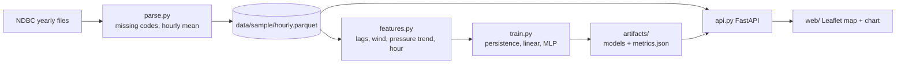

# Design notes

Deeper detail moved out of the README.

## Data

NOAA National Data Buoy Center (NDBC), historical standard meteorological data, <https://www.ndbc.noaa.gov/data/historical/stdmet/>. This is public data. Station names and positions come from NDBC's active stations list.

| Station | Where | Region |
|---|---|---|
| 44005 | Gulf of Maine | Atlantic, near Canadian waters |
| 44027 | Jonesport, Maine | Atlantic, Maine coast |
| 45005 | West Erie | Great Lakes |
| 45012 | East Lake Ontario | Great Lakes |
| 46041 | Cape Elizabeth, Washington | Pacific Northwest |
| 46005 | West Washington (offshore) | Pacific Northwest |

Years 2022 to 2024. I looked for a working public DFO/MEDS endpoint but went with NDBC because the files are simple and stable. The processed hourly table (117,495 rows, 1.8 MB) is committed in `data/sample/hourly.parquet`, so everything runs offline.

Things in the data worth knowing:

- Missing values are written as 99, 999 or 9999 depending on the column. The parser turns these into NaN, so a missing wave reading never becomes a 99 m wave.
- Stations report at different intervals (some every 10 minutes, some hourly), so everything is averaged to hourly. Wind direction is averaged as a vector.
- Some sensors have long gaps. Air temperature at 44027 and water temperature at 46041 are missing for most of 2024, so I left air and water temperature out of the features instead of throwing away those stations.
- 44005 has data only until 2024-03-25 in the NDBC historical folder, so it has no test rows.
- The Great Lakes buoys start reporting in April or May each year, so they have no winter data.

## Features, split and model

Features at time t (all use only data from t or earlier): wave height at lags 0, 1, 2, 3, 6, 12, 24 hours, wind speed at several lags, gust, wind as east/north components (now and 3 hours ago), dominant wave period, pressure and its change over 3 and 12 hours, time of day as sin/cos, and a one-hot station id. Gaps of up to 2 hours are filled forward from the last past value; any row with a missing feature is dropped.

The target is the wave height at t+3 h or t+6 h. The linear model and the MLP both predict the change from the current wave height, so "no change" is where they start.

Split by time, so no future data leaks into training:

| Split | Period | Used for |
|---|---|---|
| Train | 2022-01-01 to 2023-12-31 | fitting, and the scaler |
| Validation | 2024-01-01 to 2024-06-30 | early stopping only |
| Test | 2024-07-01 to 2024-12-31 | the numbers below |

A row only goes into a split if its label time is inside that split as well, so rows near a boundary are dropped. `tests/test_features.py` checks the no-leakage rule by scrambling everything after a cutoff and confirming earlier features do not change.

The MLP is two hidden layers of 64 units, Huber loss, AdamW, up to 40 epochs with early stopping on validation MAE. One model is trained for each horizon, pooled over all stations.

